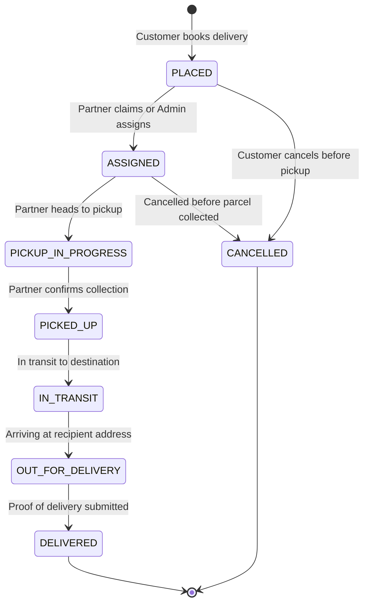

# Nextus — Full-Stack Parcel Delivery Management System (PDMS)

Nextus is a production-ready, full-stack **Parcel Delivery Management System (PDMS)** built as a modular monolith. It provides a mobile-first web app and backend covering three distinct user roles: **Customers**, **Delivery Partners**, and **Operations / Administrators**.

Brand colours: **yellow `#ffd21f`** and **red `#ed1c24`**.

---

## Architecture Overview

Nextus is structured as a robust **modular monolith** with clear separation between domains, state machines, and monetary integrity.

```
Nextus/
├── docker-compose.yml           # PostgreSQL 16 + Redis 7 + Backend container
├── .env.example                 # Root environment template
├── pdms-backend/                # NestJS 10 + TypeScript + Prisma ORM
│   ├── prisma/
│   │   ├── schema.prisma        # Complete PostgreSQL domain models & relations
│   │   ├── migrations/          # Versioned SQL migrations
│   │   └── seed.ts              # Development demo seed script
│   ├── src/
│   │   ├── admin/               # Admin dashboard, live fleet, partner approvals
│   │   ├── audit/               # Sensitive action audit trail logging
│   │   ├── auth/                # JWT + refresh-token rotation & session revocation
│   │   ├── common/              # Global filters, interceptors, RBAC guards & decorators
│   │   ├── dispatch/            # Concurrency-safe job offers & atomic claim engine
│   │   ├── earnings/            # Partner commission, payouts & settlement approval
│   │   ├── notifications/       # In-app notifications
│   │   ├── orders/              # Orders lifecycle, quotes, state machine & cancellation
│   │   ├── partners/            # Partner onboarding, KYC documents & vehicles
│   │   ├── payments/            # Idempotent payments, webhooks & HMAC verification
│   │   ├── pricing/             # Haversine distance & integer paise quotation engine
│   │   ├── prisma/              # PrismaService & connection lifecycle
│   │   ├── support/             # Customer & partner support ticket system
│   │   ├── tracking/            # Real-time Socket.IO gateway & GPS tracking milestones
│   │   ├── users/               # Customer profiles & saved addresses
│   │   └── main.ts              # Global pipes, CORS, Swagger UI & bootstrap
│   └── test/                    # E2E test suites with Supertest
└── pdms-frontend/               # React 19 + Vite 8 + React Router 7
    ├── src/
    │   ├── api/client.js        # Reusable API client with token auto-refresh
    │   ├── context/             # AuthContext & multi-step BookingContext
    │   ├── components/          # Canvas ParticleBackground
    │   └── pages/
    │       ├── landing/         # Hero landing page
    │       ├── auth/            # Customer, Partner & Admin sign-in / registration
    │       ├── customer/        # Customer booking journey, tracking, history & addresses
    │       ├── partner/         # Partner dashboard, job claims, active delivery & earnings
    │       └── admin/           # KPI dashboard, partner KYC, pricing & settlements
```

---

## Tech Stack

### Backend
- **Framework:** NestJS 10 (TypeScript)
- **Database & ORM:** PostgreSQL 16, Prisma ORM (with versioned migrations)
- **Authentication:** JWT with refresh token rotation and database-backed revocation
- **Security:** bcrypt password hashing, Role-Based Access Control (`CUSTOMER`, `PARTNER`, `ADMIN`, `OPERATIONS`), resource ownership guards, HMAC-SHA256 webhook verification
- **Monetary Storage:** Fixed-precision integer paise (e.g. ₹160.00 = `16000` paise)
- **Concurrency Protection:** Atomic conditional updates in Prisma transactions preventing multiple partners from claiming the same delivery
- **Real-Time:** Socket.IO WebSocket gateway (`/tracking` namespace)
- **API Documentation:** Swagger / OpenAPI at `/api/docs`
- **Testing:** Jest unit tests + Supertest integration/e2e tests

### Frontend
- **Framework:** React 19 + Vite 8
- **Routing:** React Router v7 (`react-router-dom`)
- **Styling:** Custom CSS with brand yellow (`#ffd21f`) and red (`#ed1c24`)
- **Icons:** `lucide-react`
- **Visuals:** Canvas particle effects (`ParticleBackground.jsx`)

---

## Demo Accounts (Development Seed Data)

After running the database seed script, the following demo accounts are available:

| Role | Identifier / Phone | Email | Password | Details |
|---|---|---|---|---|
| **Customer** | `9876543210` | `customer@example.com` | `Nextus@123` | Devi Kumar (with saved addresses & active order `PDMS-10246`) |
| **Partner (Approved)** | `9876500002` | `raj.kumar@partner.nextus.com` | `Nextus@123` | Raj Kumar (KYC Approved, Bike `TN-74-AB-1234`, assigned to `PDMS-10246`) |
| **Partner (Pending)** | `9876500003` | `arun@partner.nextus.com` | `Nextus@123` | Arun Prakash (KYC Pending verification) |
| **Administrator** | `9876500000` | `admin@nextus.com` | `Admin@123456` | Admin Nextus (Console management, pricing & KYC review) |
| **Operations** | `9876500001` | `ops@nextus.com` | `Nextus@123` | Operations Manager (Manual dispatch & ticket support) |

---

## Quick Start & Installation

### 1. Start Infrastructure (PostgreSQL & Redis)
Ensure Docker is installed and running:
```bash
docker compose up -d postgres redis
```

### 2. Configure & Migrate Backend
```bash
cd pdms-backend
cp .env.example .env
npm install
npx prisma migrate dev --name init
npx ts-node prisma/seed.ts
```

### 3. Run Backend Server
```bash
npm run start:prod
# Or in watch mode for development:
# npm run start:dev
```
- API Base URL: `http://localhost:3000/api/v1`
- Swagger OpenAPI: `http://localhost:3000/api/docs`

### 4. Run Frontend
In a separate terminal:
```bash
cd pdms-frontend
npm install
npm run dev
```
- Open web app: `http://localhost:5173/`

---

## Frontend Portals & Routes

### Customer Portal
| Route | Component | Description |
|---|---|---|
| `/` | `Landing.jsx` | Hero landing page with Call-To-Action buttons |
| `/customer/login` | `CustomerLogin.jsx` | Phone number & password sign in |
| `/customer/register` | `CustomerRegister.jsx` | Account registration |
| `/customer` | `CustomerHome.jsx` | Customer dashboard with active delivery summary |
| `/customer/book` | `BookDelivery.jsx` | Step 1: Pickup and destination route, speed selection |
| `/customer/package` | `PackageDetails.jsx` | Step 2: Weight, package category and handling notes |
| `/customer/fare` | `FareEstimate.jsx` | Step 3: Dynamic quotation from server pricing engine |
| `/customer/payment` | `Payment.jsx` | Step 4: UPI / Card / Wallet / Cash on Delivery selection |
| `/customer/confirmation` | `BookingConfirmation.jsx` | Order confirmation with tracking number |
| `/customer/track` | `TrackDelivery.jsx` | Live tracking milestones, ETA and assigned partner info |
| `/customer/orders` | `Orders.jsx` | Order history with status filters (All, Active, Delivered, Cancelled) |
| `/customer/order/:id` | `OrderDetails.jsx` | Detailed route, payments and cancellation options |
| `/customer/addresses` | `Addresses.jsx` | Saved pickup/destination addresses manager |
| `/customer/profile` | `Profile.jsx` | Account details and sign out |
| `/customer/notifications` | `Notifications.jsx` | Live order and payment alerts |

### Delivery Partner Portal
| Route | Component | Description |
|---|---|---|
| `/partner/login` | `PartnerLogin.jsx` | Partner portal login |
| `/partner/register` | `PartnerRegister.jsx` | Vehicle registration & partner onboarding |
| `/partner` | `PartnerHome.jsx` | Online/Offline toggle, active task & wallet preview |
| `/partner/requests` | `DeliveryRequests.jsx` | Open delivery jobs queue with atomic claim button |
| `/partner/active` | `ActiveDelivery.jsx` | Active pickup, transit, and delivery completion actions |
| `/partner/earnings` | `Earnings.jsx` | Partner earnings breakdown & bank payout requests |
| `/partner/history` | `DeliveryHistory.jsx` | Completed delivery archives |
| `/partner/kyc` | `KYC.jsx` | Driver license, vehicle RC and ID proof uploads |

### Administrator & Operations Console
| Route | Component | Description |
|---|---|---|
| `/admin/login` | `AdminLogin.jsx` | Administrator login |
| `/admin` | `AdminDashboard.jsx` | Real-time KPI metrics, revenue, active deliveries & partners |
| `/admin/partners` | `Partners.jsx` | Partner KYC review, document verification, approve/reject |
| `/admin/orders` | `Orders.jsx` | All orders overview & manual partner dispatch |
| `/admin/tracking` | `LiveTracking.jsx` | Live fleet GPS tracking and active delivery routes |
| `/admin/pricing` | `Pricing.jsx` | Base fares, distance rates and vehicle tier rules editor |
| `/admin/settlements` | `Settlements.jsx` | Partner payout approval and settlement execution |

---

## Delivery Lifecycle State Machine

Nextus enforces strict validation across order state transitions:



- When a delivery reaches `DELIVERED`, partner commissions (80% net) are automatically calculated and credited.
- Orders in `PICKED_UP`, `IN_TRANSIT`, or `DELIVERED` status cannot be cancelled.
- If an order with a successful payment is cancelled, an automatic `Refund` record is generated and the payment is marked `REFUNDED`.

---

## Testing

Run unit tests and end-to-end integration tests:
```bash
cd pdms-backend

# Unit tests (Pricing, Orders, Dispatch Concurrency)
npm test

# E2E integration tests (Supertest + NestJS + PostgreSQL)
npm run test:e2e
```

All 5 unit test suites and 10 E2E integration test suites run automatically against the database and mock services.

---

## License

UNLICENSED — Nextus PDMS
